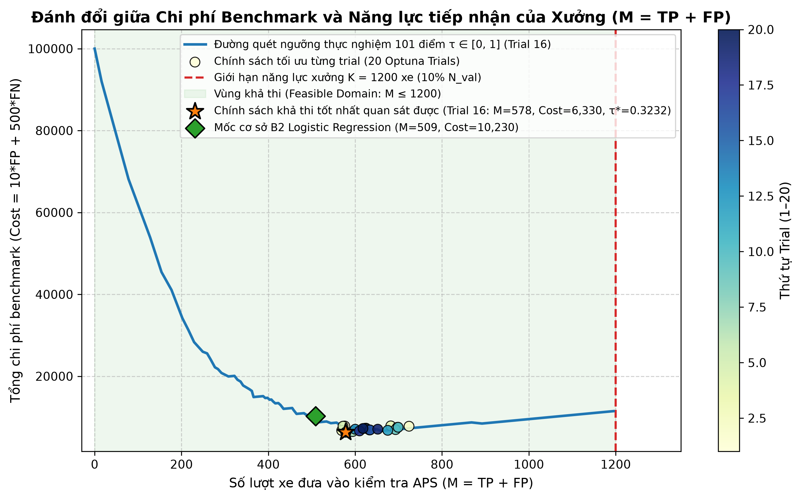

# Predictive Maintenance Cost Optimization on Scania APS Trucks

Đồ án cá nhân môn Nhập môn Tối ưu hóa, Trường Đại học Văn Lang  
Huỳnh Phúc · MSSV 2474802010314

[Báo cáo PDF](report/BAO_CAO_CUOI_KY_SCANIA_APS.pdf) · [Slide PDF](slides/SLIDES_THUYET_TRINH_SCANIA_APS.pdf) · [Hướng dẫn chạy](HUONG_DAN_CHAY.md)

Từ thư mục gốc với Python 3.11.9, cài lockfile Phase 2 rồi chạy `python app.py`. Mở [localhost:8501](http://localhost:8501). [Hướng dẫn Web Demo](WEB_DEMO.md)

Demo trên terminal:

```powershell
python scripts/demo.py
python scripts/demo.py --verify
```

## Problem Statement

Với dữ liệu cảm biến xe tải Scania, xưởng cần quyết định lượt xe nào nên được kiểm tra chuyên sâu hệ thống khí nén (APS). Chi phí benchmark là 10 đơn vị cho một lượt kiểm tra thừa và 500 đơn vị cho một ca lỗi APS bị bỏ sót. Đồ án chọn siêu tham số mô hình và ngưỡng kiểm tra để giảm tổng chi phí trong giới hạn xưởng kiểm tra tối đa 10% số lượt xe.

## Optimization Formulation

Vector quyết định là $(\theta,\tau)\in\Theta\times[0,1]$. Với điểm dự báo lỗi APS $p_i(\theta)$, xe $i$ được đưa vào kiểm tra khi $a_i(\theta,\tau)=\mathbb{I}[p_i(\theta)\ge\tau]$.

$$\min_{\theta,\tau}\ f(\theta,\tau)=10\,FP(\theta,\tau)+500\,FN(\theta,\tau)$$

$$g(\theta,\tau)=TP(\theta,\tau)+FP(\theta,\tau)-\lfloor N/10\rfloor \le 0$$

Ở đây $FP$ là số lượt kiểm tra thừa, $FN$ là số ca lỗi bị bỏ sót và $M=TP+FP$ là số lượt kiểm tra. Trần $K=\lfloor N/10\rfloor$ bằng 1.200 trên Validation và 1.600 trên Official Test.

| Siêu tham số Random Forest | Miền tìm kiếm |
|---|---|
| n_estimators | 20, 30, 40, 50, 60 |
| max_depth | Số nguyên từ 4 đến 12 |
| min_samples_split | Số nguyên từ 2 đến 10 |
| max_features | Số thực từ 0,20 đến 0,50 |

Các thiết lập cố định là class_weight="balanced", bootstrap=True, random_state=42 và n_jobs=1. [Cấu hình Phase 2](configs/scania/phase2_optimization.json)

## Dataset

APS Failure at Scania Trucks (UCI #421) có 170 đặc trưng số ẩn danh. Nhãn pos chỉ lỗi APS, nhãn neg chỉ lỗi ở bộ phận khác. Tập phát triển có 60.000 mẫu, tách phân tầng với seed 42 thành Train 48.000 mẫu và Validation 12.000 mẫu. Bộ điền khuyết trung vị và bộ chuẩn hóa cho Logistic Regression chỉ học từ Train.

Kho đã kèm 12 tệp dữ liệu, gồm ZIP gốc UCI, CSV phát triển, mô tả, manifest thu thập, chỉ số phân vùng và dữ liệu Train/Validation đã tiền xử lý. CSV Official Test (16.000 mẫu) nằm trong ZIP UCI. Kết quả Official Test trong hồ sơ lấy từ lần đánh giá đã lưu với chính sách đóng băng. [Nguồn và mã băm dữ liệu](data/README.md)

## Method

- G4 dùng ba mô hình tham chiếu. B0 luôn chọn không kiểm tra, B1 là cây quyết định một tầng và B2 là Logistic Regression. B1/B2 được chấm ở hai ngưỡng cố định 0,5 và $10/510$. G4 có hai lần fit.
- Phase 2 dùng Optuna TPE với seed 42 và ngân sách 20 trial tuần tự, một lần fit trên Train cho mỗi trial, một luồng CPU, tối đa 900 giây và 2.048 MB RAM.
- Với mỗi trial, bộ tối ưu chấm các điểm xác suất duy nhất trên Validation cùng hai đầu mút 0 và 1. Trong các ngưỡng khả thi, thứ tự chọn là chi phí nhỏ nhất, ít lượt kiểm tra nhất rồi ngưỡng cao nhất. Lưới đều 101 điểm phục vụ vẽ biểu đồ và phân tích độ nhạy.
- G10 đánh giá chính sách đã khóa từ Trial 16. Trong lượt đánh giá lịch sử, G10 fit lại một lần trên Train và xác minh các chỉ số Validation trước khi chấm Official Test.

## Key Results

| Tập | Chính sách | Ngưỡng | TP | FP | FN | Chi phí | Lượt kiểm tra $M/K$ |
|---|---|---:|---:|---:|---:|---:|---:|
| Validation | B0 · Không kiểm tra | — | 0 | 0 | 200 | 100.000 | 0/1.200 |
| Validation | B1 · Decision Stump | 0,0196 | 160 | 253 | 40 | 22.530 | 413/1.200 |
| Validation | B2 · Logistic Regression | 0,0196 | 186 | 323 | 14 | 10.230 | 509/1.200 |
| Validation | **RF + Optuna, Trial 16** | **0,323244** | **195** | **383** | **5** | **6.330** | **578/1.200** |
| Official Test | B0 · Không kiểm tra | — | 0 | 0 | 375 | 187.500 | 0/1.600 |
| Official Test | **Chính sách đã khóa** | **0,323244** | **357** | **484** | **18** | **13.840** | **841/1.600** |

Trial 16 (lượt thứ 17) là cấu hình khả thi có chi phí thấp nhất trong 20 trial. Trên Validation, chi phí giảm 38,12% so với B2. Trên Official Test, chi phí giảm 92,62% so với B0 và Recall đạt 95,20%. Thời gian chạy toàn bộ G4, Phase 2 và G10 lần lượt là 6,06 giây, 543,06 giây và 35,68 giây. [Phân tích số liệu](docs/results_analysis.md)

### Baseline Random Forest bổ sung

Một lần fit mặc định trên cùng Train, `class_weight=None`, 100 cây, seed 42 và một luồng. Cả ba hàng đều dùng Validation với K = 1.200.

| Chính sách | Ngưỡng | TP | FP | FN | TN | Chi phí | M |
|---|---:|---:|---:|---:|---:|---:|---:|
| Random Forest mặc định | 0,5 | 144 | 19 | 56 | 11.781 | 28.190 | 163 |
| Random Forest mặc định + quét ngưỡng | 0,1 | 194 | 242 | 6 | 11.558 | **5.420** | **436** |
| RF + Optuna Trial 16 | 0,323244 | 195 | 383 | 5 | 11.417 | 6.330 | 578 |

Trên cùng mô hình mặc định, quét ngưỡng giảm 22.770 đơn vị. RF mặc định + quét ngưỡng đạt 5.420 đơn vị, thấp nhất trong các chính sách đã đánh giá trên Validation và thấp hơn Trial 16 **910 đơn vị (14,38%)**. So với Trial 16, chính sách này giảm 141 FP và 142 lượt kiểm tra, đổi lại tăng một FN và Recall giảm từ 97,50% xuống 97,00%. RF mặc định dùng `class_weight=None`, còn Trial 16 dùng `balanced`. Hai cấu hình cũng khác siêu tham số, nên phép so sánh chưa tách được đóng góp riêng của Optuna. Trial 16 vẫn là chính sách chính thức đã dùng cho kết quả G10. [Kết quả bổ sung](results/scania_aps/rf_supplement/default_rf_20261127_02/metrics.json)

### Optuna Convergence

Chi phí khả thi thấp nhất giảm từ 7.840 ở lượt đầu xuống 6.330 ở lượt thứ 17. [Lịch sử 20 trial](results/scania_aps/phase2/scania_phase2_rf_optuna_002/trials_summary.csv)


### Cost–Capacity Trade-off

Trên lưới ngưỡng của Trial 16, $\tau=0{,}04$ cần 1.314 lượt kiểm tra, vượt trần 1.200. Tại $\tau=0{,}05$, số lượt giảm còn 1.195. Khi tăng từ ngưỡng đã chọn đến 0,33, số ca bỏ sót tăng từ 5 lên 7 và chi phí tăng từ 6.330 lên 7.290. [Chính sách và lưới ngưỡng](results/scania_aps/phase2/scania_phase2_rf_optuna_002/best_policy.json)



## How to Run

Web Demo giữ các mục lịch sử và thêm dự đoán lô CSV bằng checkpoint Trial 16. Cài lockfile Phase 2 để dự đoán. Người dùng có thể đổi ngưỡng, giới hạn công suất theo tỷ lệ hoặc số lượt, xem chi phí khi có nhãn và xuất CSV. [Cách cài và chạy mẫu](WEB_DEMO.md)

```powershell
python app.py
```

Demo trên terminal cũng dùng thư viện chuẩn Python. Chế độ verify kiểm tra 32 mã băm kết quả và tính nhất quán toán học.

```powershell
python scripts/demo.py
python scripts/demo.py --verify
python scripts/demo.py --summary
python scripts/demo.py --notes
```

Dùng lockfile Phase 2 để cài môi trường thực nghiệm và kiểm thử. G3 có lockfile riêng cho tiền xử lý. Xem cách chạy trên clone và bản ZIP trong [hướng dẫn chạy](HUONG_DAN_CHAY.md).

```powershell
python -m pip install -r configs/scania/phase2_requirements.lock.txt
```

## Repository Structure

| Đường dẫn | Nội dung |
|---|---|
| [configs/](configs/) | Cấu hình, seed và tệp khóa phiên bản |
| [data/](data/) | Dữ liệu gốc UCI và dữ liệu Train/Validation đã tiền xử lý |
| [docs/](docs/) | Phân tích, quy trình và [lịch sử phát triển](docs/DEVELOPMENT_HISTORY.md) |
| [figures/](figures/) | Đồ thị khảo sát dữ liệu, hội tụ và đánh đổi |
| [notebooks/](notebooks/) | Notebook khảo sát dữ liệu |
| [report/](report/) · [slides/](slides/) | Báo cáo và slide bảo vệ |
| [results/](results/) | Kết quả CSV/JSON và minh chứng kiểm tra |
| [app.py](app.py) · [web_demo/](web_demo/) | Máy chủ cục bộ và giao diện Web Demo |
| [scripts/](scripts/) · [src/](src/) · [tests/](tests/) | Lệnh chạy, mã nguồn và kiểm thử |

## Limitations

- So sánh G4 với Phase 2 thay đổi họ mô hình, cách chọn ngưỡng và ngân sách fit. Baseline Random Forest bổ sung xác định được phần thay đổi nhờ quét ngưỡng trên cùng mô hình mặc định. Khác biệt siêu tham số và trọng số lớp giữa hai Random Forest vẫn đi cùng nhau.
- Một seed (42) chưa cho phép đo biến thiên qua các lần chạy. Trial 16 có chi phí thấp nhất trong 20 trial Optuna. Kết quả RF mặc định hiện giới hạn ở Validation.
- Kết quả dùng chi phí benchmark và trần 10% theo giả định học thuật. Checkpoint refit dùng để dự đoán dữ liệu mới trong Web Demo. Điểm chưa hiệu chỉnh và kết quả lô tải lên cần được đánh giá theo điều kiện vận hành thực tế.
- Hai lượt G10 dừng do lỗi kỹ thuật sau khi đọc CSV Test vào bộ nhớ, trước bước dự đoán và chấm điểm. Run 003 là lượt duy nhất có kết quả chấm điểm.
- Bản công bố và kho phát triển có lịch sử Git riêng. Các commit gốc được dẫn tại [Lịch sử phát triển](docs/DEVELOPMENT_HISTORY.md).

## References

- Scania CV AB. APS Failure at Scania Trucks, UCI Machine Learning Repository. [DOI 10.24432/C51S51](https://doi.org/10.24432/C51S51)
- Akiba và cộng sự (2019). Optuna: A Next-generation Hyperparameter Optimization Framework. [Bài báo](https://doi.org/10.1145/3292500.3330701)
- Bergstra và cộng sự (2011). Algorithms for Hyper-Parameter Optimization. [Bài báo](https://papers.nips.cc/paper_files/paper/2011/hash/86e8f7ab32cfd12577bc2619bc635690-Abstract.html)
