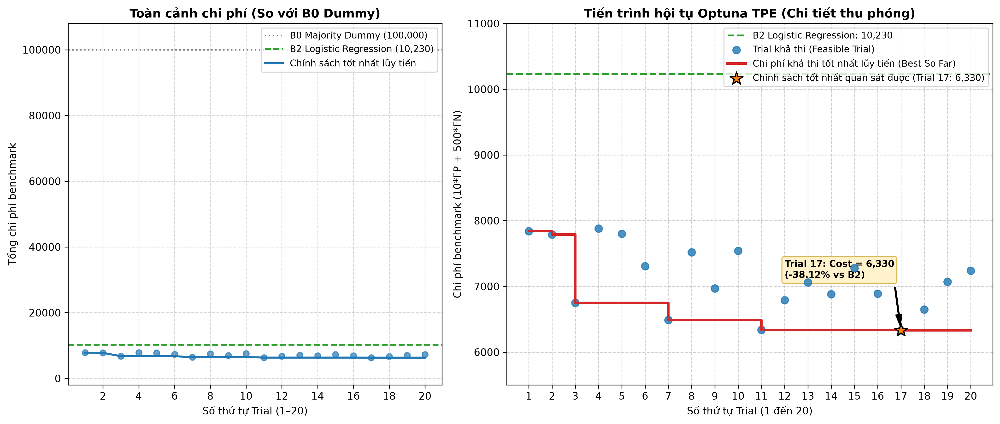

# Predictive Maintenance Cost Optimization on Scania APS Trucks (UCI #421)

[](#)
[](#)
[](https://archive.ics.uci.edu/dataset/421/aps+failure+at+scania+trucks)
[](#)
[-success.svg)](#)

> **ĐỒ ÁN CÁ NHÂN MÔN HỌC:** NHẬP MÔN TỐI ƯU HÓA — HỌC KỲ 1, NĂM HỌC 2026–2027  
> **ĐƠN VỊ ĐÀO TẠO:** KHOA CÔNG NGHỆ THÔNG TIN — TRƯỜNG ĐẠI HỌC VĂN LANG  
> **Sinh viên thực hiện:** Huỳnh Phúc (MSSV: 2474802010314)  
> **Repository chính thức:** [PhucHuynh16/scania-aps-cost-optimization](https://github.com/PhucHuynh16/scania-aps-cost-optimization)  
> **Tài liệu bàn giao:** Báo cáo [PDF](report/BAO_CAO_CUOI_KY_SCANIA_APS.pdf) / [Word](report/BAO_CAO_CUOI_KY_SCANIA_APS.docx) | Slide [PDF](slides/SLIDES_THUYET_TRINH_SCANIA_APS.pdf) / [PowerPoint](slides/SLIDES_THUYET_TRINH_SCANIA_APS.pptx) | [Script Demo](scripts/demo.py) | [Hướng dẫn chạy](HUONG_DAN_CHAY.md) | [Ma trận tuân thủ](docs/scania/FINAL_COMPLIANCE_MATRIX.md) | [Báo cáo nghiệm thu](ACCEPTANCE_REPORT.md)

---

## 1. Project Overview

Đồ án nghiên cứu bài toán **tối ưu hóa chi phí bảo trì dự đoán có ràng buộc năng lực tiếp nhận của xưởng** trên bộ dữ liệu công nghiệp **APS Failure at Scania Trucks (UCI Machine Learning Repository #421)**.

Hệ thống giải quyết bài toán lựa chọn đồng thời bộ siêu tham số $\theta$ của mô hình `RandomForestClassifier` và ngưỡng xác suất quyết định $\tau \in [0, 1]$ nhằm cực tiểu hóa hàm chi phí sai lầm bất đối xứng chuẩn benchmark IDA 2016 ($10 \cdot FP + 500 \cdot FN$), dưới ràng buộc số lượng xe đưa vào kiểm tra chuyên sâu hệ thống khí nén (APS) không vượt quá $10\%$ tổng số lượt quan sát ($M = TP + FP \le \lfloor N / 10 \rfloor$).

- **Trên tập Validation ($N = 12.000, K_{\text{val}} = 1.200$):** Phương pháp tối ưu hóa hai tầng (**Optuna TPE** kết hợp **tối ưu hóa chính xác trên tập ngưỡng ứng viên xác suất duy nhất**) trong ngân sách 20 trials tuần tự tìm được nghiệm khả thi tốt nhất quan sát được tại **Trial 16** ($\tau^* = 0.323244$), đạt chi phí **6.330 đơn vị** ($M = 578 \le 1.200$), giảm **38,12%** so với mô hình đường cơ sở tốt nhất Logistic Regression (**10.230 đơn vị**) và tiết kiệm **93,67%** so với chính sách không kiểm tra B0 (**100.000 đơn vị**).
- **Trên tập Official Test độc lập ($N = 16.000, K_{\text{test}} = 1.600$):** Khi đóng băng hoàn toàn cấu hình Trial 16 và đánh giá độc lập một lần duy nhất tại **Gate G10**, chính sách đạt tổng chi phí **13.840 đơn vị**, tiết kiệm **92,62%** so với B0 (**187.500 đơn vị**), phát hiện đúng **357/375** ca hỏng APS (**Recall 95,20%**) và sử dụng **841/1.600** lượt công suất xưởng (`FEASIBLE`).

---

## 2. Problem Statement

Trong vận tải thương mại hạng nặng, hệ thống cấp khí nén (**Air Pressure System — APS**) cung cấp khí áp suất cao cho hệ thống phanh an toàn và cơ cấu hỗ trợ sang số của xe tải Scania. Khi xe vào trạm dịch vụ với dữ liệu cảm biến thu thập được, kỹ thuật viên cần quyết định có đưa xe vào quy trình kiểm tra chuyên sâu hệ thống APS hay không trong hai điều kiện thực tế:

1. **Chi phí sai lầm bất đối xứng (50:1):** Theo chuẩn benchmark công nghiệp Scania IDA 2016, bỏ sót một xe thực sự hỏng APS dẫn đến sự cố dọc đường (**False Negative — FN**) gây thiệt hại **500 đơn vị chi phí**, gấp **50 lần** chi phí kiểm tra thừa hệ thống APS trên một xe bị lỗi ở bộ phận khác (**False Positive — FP**, tốn **10 đơn vị chi phí**).
2. **Giới hạn năng lực tiếp nhận của xưởng (Capacity Constraint):** Trạm bảo dưỡng bị giới hạn bởi số cầu nâng, thiết bị kiểm tra áp suất và kỹ thuật viên chuyên trách. Nếu hạ ngưỡng cảnh báo quá thấp để bắt hết lỗi APS, tổng số lượt xe đưa vào kiểm tra $M = TP + FP$ sẽ vượt quá năng lực phục vụ của xưởng.

**Câu hỏi tối ưu hóa cốt lõi:** *Làm thế nào xác định đồng thời bộ siêu tham số mô hình phân loại $\theta$ và ngưỡng xác suất quyết định $\tau$ để **cực tiểu hóa tổng chi phí sai lầm benchmark**, đồng thời **đảm bảo số lượt xe đưa vào kiểm tra APS không vượt quá trần công suất xưởng $10\%$**?*

---

## 3. Mathematical Formulation

Trên một phân vùng đánh giá gồm $N$ quan sát với nhãn thực tế $y_i \in \{0, 1\}$, bài toán được mô hình hóa dưới dạng tối ưu hóa có ràng buộc bất đẳng thức:

$$\min_{\theta \in \Theta,\; \tau \in [0, 1]} \quad f(\theta, \tau) = 10 \cdot FP(\theta, \tau) + 500 \cdot FN(\theta, \tau)$$

$$\text{subject to} \quad g(\theta, \tau) = M(\theta, \tau) - K \le 0, \quad \text{với } M(\theta, \tau) = TP(\theta, \tau) + FP(\theta, \tau),\; K = \left\lfloor \frac{N}{10} \right\rfloor$$

### 3.1. Biến quyết định và miền tìm kiếm ($\Omega = \Theta \times [0, 1]$)
Vector biến quyết định $x = (\theta, \tau)$ gồm hai thành phần:
- **Vector siêu tham số $\theta \in \Theta$ của `RandomForestClassifier`** (khóa trong [`configs/scania/phase2_optimization.json`](configs/scania/phase2_optimization.json)):
  - $n_{\text{estimators}} \in \{20, 30, 40, 50, 60\}$ (số cây trong rừng, bước nhảy 10).
  - $\text{max\_depth} \in \{4, 5, \dots, 12\}$ (độ sâu tối đa mỗi cây).
  - $\text{min\_samples\_split} \in \{2, 3, \dots, 10\}$ (số mẫu tối thiểu để tách nút).
  - $\text{max\_features} \in [0.20, 0.50]$ (tỷ lệ đặc trưng lấy mẫu ngẫu nhiên tại mỗi nút, biến thực liên tục).
  - Tham số cố định của estimator: `class_weight="balanced"`, `bootstrap=True`, `random_state=42`, `n_jobs=1`.
- **Ngưỡng quyết định $\tau \in [0, 1]$:** Với xác suất dự báo lớp dương $p_i(\theta) = P(y_i = 1 \mid x_i; \theta)$ từ mô hình đã huấn luyện trên tập Train, hành động kiểm tra nhị phân $a_i \in \{0, 1\}$ tuân theo quy tắc hợp đồng `P02` (giữ nguyên nhóm khi hòa xác suất):
  $$a_i(\theta, \tau) = \mathbb{I}\big(p_i(\theta) \ge \tau\big)$$

### 3.2. Hàm mục tiêu & Đơn vị đo
- $FP(\theta, \tau) = \sum_{i=1}^N (1 - y_i) a_i(\theta, \tau)$: số lượt kiểm tra thừa APS ($\times 10$ đơn vị).
- $FN(\theta, \tau) = \sum_{i=1}^N y_i (1 - a_i(\theta, \tau))$: số ca hỏng APS bị bỏ sót ($\times 500$ đơn vị).
- $TP$ và $TN$ có chi phí sai lầm bằng $0$ theo đặc tả IDA 2016. Đơn vị của $f(\theta, \tau)$ là **đơn vị chi phí benchmark quy ước** (`benchmark_cost_units`), không phải đơn vị tiền tệ thực tế.

### 3.3. Ràng buộc công suất xưởng
- Ràng buộc $M(\theta, \tau) \le K = \lfloor N/10 \rfloor$ là giả định kịch bản vận hành của đồ án:
  - Trên tập **Validation** ($N = 12.000$): $K_{\text{val}} = 1.200$ lượt xe.
  - Trên tập **Official Test** ($N = 16.000$): $K_{\text{test}} = 1.600$ lượt xe.

---

## 4. Dataset and Preprocessing

- **Nguồn dữ liệu:** *APS Failure at Scania Trucks* — UCI Machine Learning Repository **#421** ([DOI: 10.24432/C51S51](https://doi.org/10.24432/C51S51), giấy phép **CC BY 4.0**, Scania CV AB, 2016).
- **Quy mô & Đặc trưng:** Tập phát triển gốc gồm $60.000$ bản ghi, tập kiểm thử gốc gồm $16.000$ bản ghi; mỗi bản ghi có $170$ thuộc tính số ẩn danh (`aa_000` đến `ee_000`) với giá trị khuyết ký hiệu `na`.
- **Ngữ nghĩa nhãn lớp theo tài liệu gốc UCI:**
  - `pos` ($y = 1$): Xe vào xưởng do hư hỏng thực tế thuộc hệ thống khí nén APS ($1.000 / 60.000 = 1,67\%$ ở tập phát triển; $375 / 16.000 = 2,34\%$ ở tập Test).
  - `neg` ($y = 0$): Xe vào xưởng do hư hỏng ở **các bộ phận khác ngoài APS** (không đồng nghĩa xe hoàn toàn khỏe mạnh).
- **Phân vùng khóa cố định theo Giao thức G3** (`stable_digest`: `efe781b7e564073a2a764e70a41cfe5c3e8975d33cc38b0fa297ef09f51767bb`):
  - **Train:** $48.000$ mẫu ($800$ `pos`, $47.200$ `neg`) — dùng độc quyền để `fit` bộ điền khuyết `SimpleImputer(strategy="median")`, bộ chuẩn hóa `StandardScaler()` (cho Logistic Regression) và huấn luyện các mô hình.
  - **Validation:** $12.000$ mẫu ($200$ `pos`, $11.800$ `neg`), tách phân tầng `seed = 42`, rời nhau hoàn toàn với Train — dùng để so sánh baseline và chọn $(\theta, \tau)$ trong Phase 2.
  - **Official Test:** $16.000$ mẫu ($375$ `pos`, $15.625$ `neg`) — giữ niêm phong trong suốt quá trình phát triển và tối ưu hóa Phase 2; chỉ chấm điểm một lần duy nhất tại **Gate G10 Run 003** với chính sách đã khóa, không dùng để tinh chỉnh.
- Hướng dẫn tải dữ liệu, kiểm tra mã băm toàn vẹn SHA-256 và tái tạo mảng tiền xử lý được trình bày chi tiết tại [`data/README.md`](data/README.md).

---

## 5. Baseline Models

Ba mô hình đường cơ sở (Gate G4, cấu hình khóa tại [`configs/scania/g4_baselines.json`](configs/scania/g4_baselines.json)) được đánh giá trên cùng phân vùng Validation $12.000$ mẫu để tạo mốc tham chiếu:

1. **B0 — Majority Dummy:** Luôn dự đoán $a_i = 0$ (không kiểm tra APS), tạo mốc chi phí trần $500 \times 200 = 100.000$ đơn vị trên Validation ($187.500$ đơn vị trên Official Test).
2. **B1 — Decision Stump:** `DecisionTreeClassifier(max_depth=1, random_state=42)` trên dữ liệu đã điền khuyết trung vị, chấm tại hai ngưỡng cố định: ngưỡng mặc định $\tau = 0,5000$ ($100.000$ đơn vị) và ngưỡng tỷ lệ chi phí Bayes $\tau = 10/510 \approx 0,0196$ ($22.530$ đơn vị, $M = 413 \le 1.200$).
3. **B2 — Logistic Regression:** `LogisticRegression(C=1.0, solver="lbfgs", max_iter=2000, random_state=42)` trên đặc trưng đã chuẩn hóa `StandardScaler`, chấm tại $\tau = 0,5000$ ($35.980$ đơn vị, $M = 177$) và $\tau = 10/510 \approx 0,0196$ (**$10.230$ đơn vị**, $M = 509 \le 1.200$ — mốc cơ sở tốt nhất của G4).

---

## 6. Random Forest and Optuna TPE

Phương pháp tối ưu hóa có ràng buộc trong Phase 2 ([`src/scania/phase2_optimization.py`](src/scania/phase2_optimization.py)) giải bài toán hai tầng lồng nhau:

- **Tầng ngoài (Hyperparameter Search với Optuna TPE):**
  - Sử dụng `optuna.samplers.TPESampler(seed=42)` duyệt tuần tự đúng **20 trials** (`total_max_fits = 20`, đúng 1 lần `model.fit()` trên 48.000 mẫu Train cho mỗi trial) trong tiến trình cô lập Windows Job Object (`1` luồng tính toán bản địa, trần RAM `2048 MB`, giới hạn thời gian `900s`).
- **Tầng trong (Exact Constrained Threshold Optimization — không refit):**
  - Với vector xác suất dự báo Validation $p(\theta) \in [0, 1]^{12000}$ của mỗi trial, thuật toán sinh tập ứng viên đầy đủ $T(p) = \{0.0, 1.0\} \cup \text{unique}(p(\theta))$ và tính vector hóa chính xác $(TP, FP, FN, M, \text{Cost})$ cho **toàn bộ các ngưỡng ứng viên xác suất duy nhất** thông qua sắp xếp và mảng tổng tích lũy.
  - Lọc các ngưỡng thỏa mãn $M \le 1.200$, chọn ngưỡng có `total_cost` nhỏ nhất theo thứ tự phá hòa tất định `(total_cost, M, -threshold)` để trả giá trị mục tiêu về cho Optuna TPE.
  - **Phân biệt với lưới 101 điểm:** Bên cạnh nghiệm ứng viên chính xác $\tau^*$, hệ thống tính thêm một lưới đều **101 điểm** $\tau \in \{0.00, 0.01, \dots, 1.00\}$ lưu vào `threshold_curve` chỉ nhằm phục vụ vẽ đồ thị đánh đổi và khảo sát độ nhạy, không làm giảm độ phân giải của bước chọn ngưỡng $\tau^*$.

---

## 7. Experimental Results

| Tiêu chí đo đạc | G4 B0: Majority Dummy | G4 B1: Decision Stump | G4 B2: Logistic Reg. | **Phase 2: RF + Optuna (Trial 16)** | **Gate G10: Official Test (Run 003)** |
|---|:---:|:---:|:---:|:---:|:---:|
| **Phân vùng đánh giá** | Validation | Validation | Validation | **Validation** | **Official Test (Độc lập)** |
| **Số quan sát ($N$) / Ca lỗi ($P$)** | 12.000 / 200 | 12.000 / 200 | 12.000 / 200 | **12.000 / 200** | **16.000 / 375** |
| **Ngưỡng quyết định $\tau$** | N/A | $0,0196$ | $0,0196$ | $\mathbf{0,323244}$ | $\mathbf{0,323244}$ (Đóng băng) |
| **True Positives (TP)** | 0 | 160 | 186 | **195** | **357** |
| **False Positives (FP)** | 0 | 253 | 323 | **383** | **484** |
| **False Negatives (FN)** | 200 | 40 | 14 | **5** | **18** |
| **True Negatives (TN)** | 11.800 | 11.547 | 11.477 | **11.417** | **15.141** |
| **Độ nhạy (Recall)** | 0,00% | 80,00% | 93,00% | **97,50%** | **95,20%** ($357/375$) |
| **Độ chính xác (Precision)** | N/A | 38,74% | 36,54% | **33,74%** | **42,45%** ($357/841$) |
| **ROC-AUC / PR-AUC** | N/A | 0,8893 / 0,3133 | 0,9825 / 0,7558 | **0,9903 / 0,7059** | **0,9861 / 0,7495** |
| **Chi phí kiểm tra ($10 \times FP$)** | 0 | 2.530 | 3.230 | **3.830** | **4.840** |
| **Chi phí bỏ sót ($500 \times FN$)** | 100.000 | 20.000 | 7.000 | **2.500** | **9.000** |
| **TỔNG CHI PHÍ BENCHMARK** | **100.000** | **22.530** | **10.230** | **6.330** | **13.840** |
| **Lượt xe vào xưởng ($M \le K$)** | $0 \le 1.200$ | $413 \le 1.200$ | $509 \le 1.200$ | **$578 \le 1.200$** | **$841 \le 1.600$** |
| **Trạng thái ràng buộc** | FEASIBLE | FEASIBLE | FEASIBLE | **FEASIBLE (Dư 622)** | **FEASIBLE (Dư 759)** |
| **Tiết kiệm so với B0 Dummy** | 0,00% | 77,47% | 89,77% | **93,67%** | **92,62%** ($-173.660$ đv) |
| **Giảm chi phí so với B2 (G4)** | N/A | $+12.300$ | Mốc G4 | **$-38,12\%$ ($-3.900$ đv)** | N/A (Khác phân vùng) |

- **Cấu hình khả thi tốt nhất quan sát được trong 20 trials Optuna (`trial_number = 16` theo chỉ số 0-indexed, tức lượt chạy thứ 17/20):** `n_estimators = 50`, `max_depth = 10`, `min_samples_split = 10`, `max_features = 0.4268663927182804`, $\tau^* = 0.3232440937634324$.
- **Tiêu thụ tài nguyên thực tế:** G4 chạy trong `6,06s` (2 fits `1,42s`, đỉnh RAM `201,90 MB`); Phase 2 hoàn tất 20 trials trong `543,06s` (đỉnh RAM `159,82 MB`); Gate G10 hoàn tất 1 lần refit (`31,05s`) và suy luận 16.000 mẫu Test (`0,039s`) trong tổng thời gian `35,68s`.

---

## 8. Optimization Convergence

Đồ thị biểu diễn chi phí của từng trial và đường bao chi phí khả thi thấp nhất lũy tiến (`best-so-far`) qua 20 trials của Optuna TPE trên tập Validation (`scania_phase2_rf_optuna_002`). Chi phí khả thi tốt nhất giảm từ $7.840$ (Trial 0) $\to 7.790$ (Trial 1) $\to 6.750$ (Trial 2) $\to 6.490$ (Trial 6) $\to 6.340$ (Trial 10) xuống mức thấp nhất quan sát được là **$6.330$** tại `trial_number = 16` (hiển thị ở vị trí thứ tự **Trial 17** trên trục hoành đánh số từ $1$ đến $20$). Đây là nghiệm khả thi tốt nhất quan sát được trong ngân sách 20 trials, không phải chứng minh hội tụ về cực tiểu toàn cục:



---

## 9. Cost-Capacity Trade-off

Đồ thị kết hợp đường quét ngưỡng đều 101 điểm $\tau \in [0, 1]$ của cấu hình Trial 16 với phân bố của 20 trials Optuna trong miền khả thi $M \le 1.200$:


**Phân tích độ nhạy ngưỡng trích xuất trực tiếp từ `threshold_curve` của Trial 16 ([`results/scania_aps/phase2/scania_phase2_rf_optuna_002/best_policy.json`](results/scania_aps/phase2/scania_phase2_rf_optuna_002/best_policy.json)):**
1. **Ranh giới khả thi công suất xưởng nằm giữa $\tau = 0,04$ và $\tau = 0,05$:**
   - Trong trường hợp không ràng buộc và xác suất được hiệu chuẩn hoàn hảo, ngưỡng lý thuyết Bayes là $\tau^*_{\text{Bayes}} = \frac{10}{10 + 500} \approx 0,0196$. Tuy nhiên, do Random Forest sử dụng `class_weight="balanced"`, điểm xác suất dự báo lớp dương được đẩy cao; với $\tau \in \{0,00; 0,01; 0,02; 0,03; 0,04\}$, số xe đưa vào kiểm tra vượt trần $1.200$ (tại $\tau = 0,04$ có $M = 1.314 > 1.200$, `INFEASIBLE`).
   - Từ $\tau = 0,05$ trở lên, chính sách **đã thỏa mãn ràng buộc công suất**: tại $\tau = 0,05$ có $M = 1.195 \le 1.200$ (`FEASIBLE`, chi phí $11.480$); tại $\tau = 0,09$ có $M = 955 \le 1.200$ (`FEASIBLE`, chi phí $9.080$).
2. **Vùng chi phí thấp $\tau \in [0,20; 0,32]$:** Số ca bỏ sót $FN$ giữ ở mức $4$–$5$ ca trong khi $FP$ giảm dần từ $505$ xuống $385$, giúp chi phí nằm trong khoảng $[6.350; 7.050]$ ($\tau = 0,20$: $7.050$; $\tau = 0,30$: $6.500$; $\tau = 0,32$: $6.350$) và đạt cực tiểu quan sát được $6.330$ tại ứng viên xác suất chính xác $\tau^* = 0,323244$.
3. **Độ dốc bất đối xứng khi $\tau \ge 0,33$:** Do mỗi ca bỏ sót bị phạt $500$ đơn vị, khi tăng ngưỡng qua $0,33$, số ca $FN$ tăng lên $7$ ($\tau = 0,33 \Rightarrow \text{Cost} = 7.290$), $9$ ($\tau = 0,34 \Rightarrow \text{Cost} = 8.230$), $10$ ($\tau = 0,35 \Rightarrow \text{Cost} = 8.670$) và $16$ ($\tau = 0,50 \Rightarrow \text{Cost} = 10.950$).

---

## 10. Installation and Usage

### 10.1. Thiết lập môi trường Python 3.11
- Hệ điều hành kiểm nghiệm: Windows 10/11 (x64) với **Python 3.11.x** (đã kiểm tra thực tế trên Python `3.11.9`).
- Cài đặt thư viện (có thể dùng `requirements.txt` hoặc bản khóa phiên bản thực nghiệm `configs/scania/phase2_requirements.lock.txt`):
```powershell
python -m venv .venv
.\.venv\Scripts\Activate.ps1
pip install -r requirements.txt
```

### 10.2. Phân biệt rõ ba chế độ sử dụng (Modes A, B, C)

#### Chế độ A — Trình diễn kết quả đã lưu & Kiểm tra toàn vẹn (Read-Only Demo, khuyến nghị khi chấm/bảo vệ)
Chế độ này **không cần dữ liệu thô dung lượng lớn**, không huấn luyện mô hình và không thực hiện suy luận mới; script đọc trực tiếp các tệp JSON/CSV kết quả đã nghiệm thu, kiểm định chéo công thức toán học và kiểm tra mã băm toàn vẹn SHA-256 trên toàn bộ **32/32 artifacts** thực nghiệm:
```powershell
# Chạy đầy đủ quy trình thuyết trình bảo vệ 5–7 phút kèm kiểm tra SHA-256
python scripts/demo.py

# Chỉ in các bảng đối chiếu kết quả G4, Phase 2 và Gate G10
python scripts/demo.py --summary

# Chỉ kiểm tra tính nhất quán toán học & mã băm SHA-256 (trả mã thoát khác 0 nếu lỗi)
python scripts/demo.py --verify

# Chỉ in dàn ý thuyết trình 5–7 phút
python scripts/demo.py --notes

# Kiểm tra mã băm SHA-256 của Gate G10 và chạy kiểm thử đơn vị
python scripts/run_scania_g10.py verify
python -m pytest tests/scania/test_cost_model.py tests/scania/test_constraints.py tests/scania/test_evaluation.py tests/scania/test_baselines.py tests/scania/test_pipeline.py tests/scania/test_g10_evaluation.py -k "not test_official_test_unsealed_fails_without_authorization and not test_synthetic_end_to_end_pipeline" -v
```

#### Chế độ B — Tái lập quy trình tiền xử lý, huấn luyện & tối ưu hóa
- Toàn bộ 12 tệp dữ liệu gốc UCI #421 và dữ liệu tiền xử lý G3 (`data/raw/scania_aps/` và `data/processed/scania_aps/official_20261029_04/`, tổng cộng ~257,5 MiB) đã được đính kèm trực tiếp trong repository (tệp `aps_failure_test_set.csv` vẫn giữ niêm phong bên trong `aps+failure+at+scania+trucks.zip`). Xem chi tiết mã băm SHA-256 và lệnh tái tạo tại [`data/README.md`](data/README.md).
- Có thể chạy kiểm thử đường ống tối ưu trên dữ liệu tổng hợp bất kỳ lúc nào (không chạm dữ liệu thật):
  ```powershell
  python -m scripts.run_scania_phase2 synthetic --run-id phase2_synthetic_check --trials 3
  python scripts/run_scania_g10.py synthetic
  ```
- Các lệnh chạy thực nghiệm thật (`run_scania_phase2.py execute`, `run_scania_g10.py execute`) áp dụng cơ chế khóa an toàn (`fail-closed`): yêu cầu kho Git sạch, dữ liệu G3 khớp mã băm và bản ghi phê duyệt gắn với commit SHA để tránh ghi đè bằng chứng gốc hoặc mở lại tập Test trái phép.

#### Chế độ C — Suy luận trực tiếp trên dữ liệu mới (Live Inference)
- Dự án **không lưu trữ sẵn tệp trọng số mô hình Random Forest đã huấn luyện (`.joblib`/`.pkl`)** trong repository; các lượt chạy Phase 2 chỉ lưu cấu hình siêu tham số, ngưỡng tối ưu và bảng chỉ số, còn Gate G10 thực hiện tái huấn luyện xác định một lần trên tập Train (`DETERMINISTIC_TRAIN_REFIT_EVALUATION`).
- Do đó, không thể gọi suy luận `zero-fit` ngay lập tức trên mẫu xe mới nếu chưa chạy bước huấn luyện lại `RandomForestClassifier` với bộ tham số đóng băng trong [`configs/scania/g10_evaluation.json`](configs/scania/g10_evaluation.json) kèm `tree_preprocessor.joblib` từ bước G3.

---

## 11. Repository Structure

```text
scania-aps-cost-optimization/
├── README.md                                    # Tổng quan bài toán, mô hình tối ưu, kết quả và hướng dẫn chạy
├── HUONG_DAN_CHAY.md                            # Hướng dẫn chi tiết 3 chế độ vận hành (A: Demo, B: Tái lập, C: Suy luận)
├── ACCEPTANCE_REPORT.md                         # Báo cáo nghiệm thu kỹ thuật, kiểm kê dữ liệu và kết quả kiểm thử
├── requirements.txt                             # Khai báo các gói thư viện Python 3.11
├── .gitignore                                   # Quy tắc loại trừ dữ liệu lớn, môi trường ảo và bộ nhớ đệm
├── .gitattributes                               # Quy tắc chuẩn hóa dòng văn bản và tệp nhị phân
│
├── configs/
│   └── scania/
│       ├── g3_pipeline.json                     # Cấu hình nguồn dữ liệu và mã băm gốc G3
│       ├── g4_baselines.json                    # Cấu hình tham số và ngưỡng cố định cho B0, B1, B2
│       ├── phase2_optimization.json             # Cấu hình không gian tìm kiếm Optuna TPE & ràng buộc K=1200
│       ├── g10_evaluation.json                  # Cấu hình chính sách đóng băng Trial 16 cho Gate G10
│       ├── g3_requirements.lock.txt             # Phiên bản thư viện khóa tại G3
│       ├── phase2_requirements.lock.txt         # Phiên bản thư viện khóa tại Phase 2 (Python 3.11.9)
│       └── authorizations/                      # Hồ sơ tham chiếu ủy quyền thực thi các lượt chạy thực nghiệm
│
├── data/
│   ├── README.md                                # Nguồn gốc UCI #421, mã băm SHA-256 và quy trình tái tạo G3
│   ├── raw/scania_aps/                          # Dữ liệu gốc UCI #421 (ZIP gốc niêm phong Test, Training CSV, mô tả & manifest)
│   └── processed/scania_aps/                    # Phân vùng G3 official_split.json & official_20261029_04 (.npy, .npz, .joblib)
│
├── docs/
│   ├── results_analysis.md                      # Phân tích chi tiết kết quả G4, Phase 2 và Gate G10
│   ├── reproducibility_evidence.md              # Tổng hợp thông số môi trường và mã băm SHA-256
│   └── scania/
│       ├── FINAL_COMPLIANCE_MATRIX.md           # Ma trận đối chiếu tuân thủ học thuật cuối kỳ
│       ├── ACCEPTANCE_REPORT.md                 # Bản sao đồng bộ báo cáo nghiệm thu kỹ thuật
│       ├── problem_formulation.md               # Đặc tả toán học và quy ước ngưỡng P02
│       ├── cost_model_review.md                 # Kiểm tra đại số hàm chi phí IDA 2016
│       ├── experimental_protocol.md             # Giao thức phân vùng dữ liệu và ranh giới Test
│       ├── data_dictionary.md                   # Từ điển 170 thuộc tính cảm biến Scania APS
│       └── eda_findings.md                      # Kết quả kiểm toán dữ liệu nguồn G2
│
├── figures/
│   └── optimization/
│       ├── optimization_convergence.png         # Hình 1: Tiến trình tìm kiếm 20 trials Optuna TPE
│       └── cost_vs_capacity_tradeoff.png        # Hình 2: Đường cong đánh đổi chi phí & năng lực xưởng
│
├── notebooks/
│   └── scania/
│       └── 00_source_audit.ipynb                # Notebook kiểm toán dữ liệu nguồn Scania APS (G2)
│
├── report/
│   ├── BAO_CAO_CUOI_KY_SCANIA_APS.md            # Bản thảo Markdown báo cáo tổng kết
│   ├── BAO_CAO_CUOI_KY_SCANIA_APS.docx          # Báo cáo định dạng Microsoft Word
│   └── BAO_CAO_CUOI_KY_SCANIA_APS.pdf           # Báo cáo định dạng PDF chuẩn in A4 (9 trang)
│
├── slides/
│   ├── SLIDES_THUYET_TRINH_SCANIA_APS.md        # Nội dung chi tiết 8 slide thuyết trình
│   ├── SLIDES_THUYET_TRINH_SCANIA_APS.pptx      # Slide trình chiếu PowerPoint 16:9 (8 slide)
│   └── SLIDES_THUYET_TRINH_SCANIA_APS.pdf       # Slide định dạng PDF (8 slide)
│
├── scripts/
│   ├── demo.py                                  # Script demo đọc kết quả lưu trữ & kiểm tra toàn vẹn 32 artifacts
│   ├── diagnose_scania_native_pools.py          # Công cụ kiểm tra giới hạn luồng thư viện số học bản địa
│   ├── run_scania_acquire.py                    # Tải và xác minh tệp gốc UCI #421 (giữ niêm phong Test)
│   ├── run_scania_pipeline.py                   # Tách Train/Validation G3 và fit bộ tiền xử lý
│   ├── run_scania_gate_b1.py                    # Kiểm thử hạ tầng cô lập tiến trình Windows Job Object
│   ├── run_scania_baselines.py                  # Điều phối chạy và kiểm chứng G4 Baselines
│   ├── run_scania_phase2.py                     # Điều phối tối ưu hóa Phase 2 và xuất đồ thị
│   └── run_scania_g10.py                        # Điều phối đánh giá và kiểm tra mã băm Gate G10
│
├── src/
│   └── scania/                                  # Các module cài đặt hàm chi phí, ràng buộc, TPE, G10 & Job Object
│
├── tests/
│   └── scania/                                  # Bộ kiểm thử đơn vị tự động cho toàn bộ quy trình Scania APS
│
└── results/
    └── scania_aps/                              # Artifacts kết quả thực nghiệm JSON/CSV/checksums
        ├── g3/official_20261029_04/             # Manifest phân vùng dữ liệu G3 chính thức
        ├── g4/                                  # Kết quả G4 Baselines (scania_g4_b2_real_001 & 002)
        ├── phase2/                              # Lịch sử 20 trials Optuna TPE (scania_phase2_rf_optuna_001 & 002)
        └── g10/scania_g10_official_test_003/    # Kết quả đánh giá độc lập Official Test (Gate G10 Run 003)
```

---

## 12. Limitations

1. **Thực nghiệm đơn hạt giống (`seed = 42`):** Quá trình lấy mẫu của Optuna TPE và huấn luyện Random Forest trong Phase 2 chỉ chạy với một hạt giống ngẫu nhiên cố định (`seed = 42`) trong ngân sách 20 trials tuần tự. Do đó, nghiên cứu chưa định lượng được trung bình và độ lệch chuẩn (`mean ± std`) của chi phí tối ưu qua nhiều hạt giống ngẫu nhiên khác nhau, và nghiệm Trial 16 là nghiệm khả thi tốt nhất quan sát được trong 20 trials chứ không phải nghiệm tối ưu toàn cục.
2. **Khác biệt ngân sách tính toán và thiếu baseline Random Forest mặc định:** Các mô hình cơ sở G4 (`B1` Decision Stump, `B2` Logistic Regression) chỉ thực hiện tổng cộng 2 lượt `fit` (`1,42s`) tại hai ngưỡng cố định ($\tau = 0,5$ và $\tau = 10/510$), không quét ngưỡng tối ưu và không bao gồm một mô hình `RandomForestClassifier` cấu hình mặc định chưa tinh chỉnh. Vì vậy, mức giảm $38,12\%$ chi phí Validation so với `B2` phản ánh hiệu quả tổng hợp của việc chuyển sang họ mô hình phi tuyến Random Forest kết hợp tìm kiếm siêu tham số TPE và chọn ngưỡng có ràng buộc, chứ không tách biệt riêng phần đóng góp thuần túy của bộ tối ưu Optuna.
3. **Mô hình chi phí tĩnh và giả định công suất 10%:** Công thức $10 \cdot FP + 500 \cdot FN$ là hàm mục tiêu quy ước trên dữ liệu bảng tĩnh của IDA 2016 (không có định danh xe hay chuỗi thời gian), và giới hạn $M \le \lfloor N/10 \rfloor$ là giả định kịch bản học thuật của đồ án. Kết quả không phải là số tiền tiết kiệm tài chính thực tế tại doanh nghiệp và không thay thế bài toán lập lịch bảo dưỡng động.
4. **Không lưu checkpoint mô hình `.joblib` và lịch sử truy cập tệp ở G10 Runs 001/002:** Dự án không lưu tệp nhị phân của mô hình Random Forest sau Phase 2 nên Gate G10 thực hiện 1 lần huấn luyện lại xác định trên tập Train (`DETERMINISTIC_TRAIN_REFIT_EVALUATION`, khớp chính xác 100% chỉ số Validation trước khi chấm Test). Ở hai lần chạy lỗi kỹ thuật trước đó (`scania_g10_official_test_001` và `002`, được lưu trữ trong bản sao lưu gốc), tệp CSV Test đã được đọc vào bộ nhớ trước khi tiến trình dừng tại bước kiểm tra đường dẫn/import của `tree_preprocessor.joblib`; hoàn toàn không có bước dự đoán xác suất hay điều chỉnh tham số nào sử dụng dữ liệu Test.
5. **Nguồn gốc phiên bản & Lịch sử phát triển Git:** Bản công bố này được trích xuất từ nhánh nghiệm thu `antigravity/sc-final-deliverables` tại commit `93d2163e8a4bf31396eaa59b3098f3f6fdb4bf82` của kho phát triển gốc (`https://github.com/PhucHuynh16/Predictive-maintenance-cost-optimization`), nơi bảo toàn đầy đủ hơn 45 commits lịch sử phát triển thực tế từ ngày `2026-10-21` qua các cổng kiểm định kỹ thuật G1–G10.

---

## 13. References

1. **Scania CV AB (2016).** *APS Failure at Scania Trucks.* UCI Machine Learning Repository, Dataset #421. DOI: [10.24432/C51S51](https://doi.org/10.24432/C51S51). License: CC BY 4.0.
2. **Lindgren, T., & Biteus, J. (2016).** *IDA 2016 Industrial Challenge: Using Reflectance and Sensor Data to Predict APS Failure in Scania Trucks.* 15th International Symposium on Intelligent Data Analysis (IDA 2016), Stockholm, Sweden.
3. **Elkan, C. (2001).** *The Foundations of Cost-Sensitive Learning.* Proceedings of the 17th International Joint Conference on Artificial Intelligence (IJCAI'01), pp. 973–978.
4. **Breiman, L. (2001).** *Random Forests.* Machine Learning, 45(1), pp. 5–32.
5. **Akiba, T., Sano, S., Yanase, T., Ohta, T., & Koyama, M. (2019).** *Optuna: A Next-generation Hyperparameter Optimization Framework.* Proceedings of the 25th ACM SIGKDD International Conference on Knowledge Discovery & Data Mining (KDD '19), pp. 2623–2631.
6. **Bergstra, J., Bardenet, R., Bengio, Y., & Kégl, B. (2011).** *Algorithms for Hyper-Parameter Optimization (Tree-structured Parzen Estimator — TPE).* Advances in Neural Information Processing Systems (NeurIPS 2011), Vol. 24.
