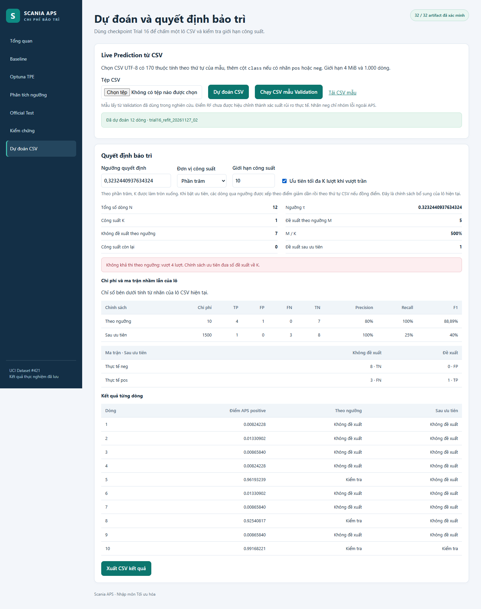

# Web Demo Scania APS

## Môi trường và khởi động

Dùng Python 3.11.9 tại thư mục có `app.py`. Cài lockfile để dùng checkpoint và bộ tiền xử lý đã lưu:

```powershell
python -m venv .venv
.\.venv\Scripts\python.exe -m pip install -r configs/scania/phase2_requirements.lock.txt
.\.venv\Scripts\python.exe app.py
```

Mở [localhost:8501](http://localhost:8501). Với môi trường đã kích hoạt, lệnh tương đương là `python app.py`. Nếu cổng đang bận, thêm `--port 8502` và mở [localhost:8502](http://localhost:8502). Dừng bằng Ctrl+C. Sau khi cài môi trường, ứng dụng hoạt động ngoại tuyến. Sáu mục trình bày lịch sử vẫn dùng thư viện chuẩn Python.

Trong mục **Baseline**, màu xanh đánh dấu chính sách có chi phí thấp nhất trong các kết quả Validation. Mục **Optuna TPE** trình bày riêng Trial 16, trial có chi phí thấp nhất trong 20 lượt Optuna.

## Dự đoán và quyết định bảo trì

1. Mở **Dự đoán CSV** rồi chọn **Chạy CSV mẫu Validation** hoặc tải CSV của mình. Tệp phải dùng UTF-8, dấu phẩy và đúng thứ tự 170 thuộc tính. Cột `class` chứa `pos` hoặc `neg` nếu có nhãn. Ô rỗng và `na` được điền bằng trung vị đã học trên Train. Giới hạn là 4 MiB và 1.000 dòng.
2. Xem điểm APS positive và đề xuất từng dòng. Checkpoint `trial16_refit_20261127_02` dùng ngưỡng mặc định `0.3232440937634324`. Điểm mô hình chưa qua hiệu chỉnh xác suất rủi ro thực tế.
3. Đổi ngưỡng hoặc công suất để tính lại quyết định từ điểm của lô. Ở chế độ phần trăm, `K = floor(N × tỷ lệ)` và mặc định là 10%. Bật ưu tiên để giữ tối đa K trong các đề xuất qua ngưỡng, theo điểm giảm dần và thứ tự CSV khi đồng điểm. Chính sách ưu tiên này dành riêng cho lô hiện tại.
4. Khi có nhãn, bảng hiển thị chi phí `10 × FP + 500 × FN`, Precision, Recall, F1 và ma trận nhầm lẫn của lô. Khi thiếu nhãn, Web Demo chỉ hiển thị điểm và quyết định.
5. Chọn **Xuất CSV kết quả** để lưu mã dòng, điểm, ngưỡng, hai quyết định, công suất, phiên bản mô hình và chính sách. CSV tải lên được xử lý trong bộ nhớ của máy chủ cục bộ.



[Mẫu 12 dòng Validation](data/examples/scania_validation_sample.csv) gồm 4 pos và 8 neg theo thứ tự membership đã khóa. Mẫu minh họa thuộc dữ liệu nghiên cứu đã dùng. [Xuất xứ mẫu](data/examples/sample_provenance.json)

## Kiểm chứng

```powershell
.\.venv\Scripts\python.exe app.py --verify
.\.venv\Scripts\python.exe -m unittest discover -s tests -p test_live_prediction.py -v
.\.venv\Scripts\python.exe -m unittest discover -s tests -p test_web_demo.py -v
```

`--verify` kiểm tra 32 artifact lịch sử, 20 trial và 101 điểm Validation. Mỗi yêu cầu dự đoán xác minh SHA-256 của mô hình nội bộ và preprocessor G3. Các chỉ số Official Test hiển thị riêng từ kết quả G10 đã lưu.
